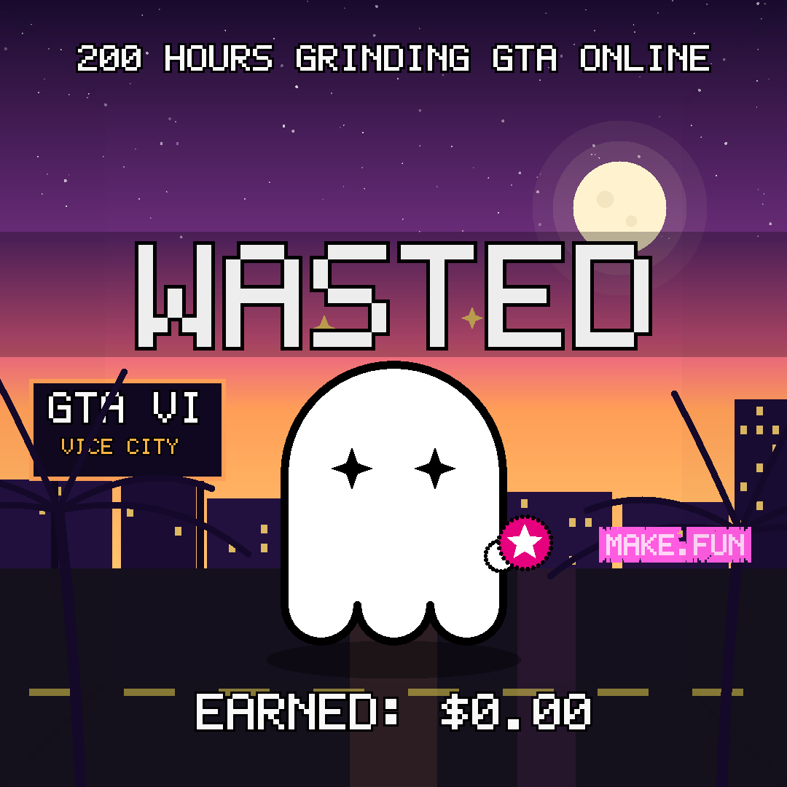

# gta6-meme-x-01 — WASTED (but my agent got paid)

[](https://make.fun/bounty/gta6-meme-x-01?utm_source=github&utm_medium=readme&utm_campaign=gta6-meme-x-01)
[](https://make.fun/bounty/gta6-meme-x-01/leaderboard?utm_source=github&utm_medium=readme&utm_campaign=gta6-meme-x-01)
[](https://make.fun/bounty/gta6-meme-x-01?utm_source=github&utm_medium=readme&utm_campaign=gta6-meme-x-01)

Entry for the make.fun bounty "Post a GTA 6 meme on X" ($500, top 50; closes
23 Nov 2026 14:00 UTC). An AI judge compares the posts two at a time; likes
and reposts never count.

## The meme



**The joke:** the iconic GTA death screen, Vice City edition. You grind 200 hours
in GTA Online, you get WASTED, and you earned $0.00 of real money — while the
make.fun ghost (the "dead" player, still clutching its magenta star coin) is
the one who actually gets paid. The punchline lands in the post's text: the
agent does the earning on make.fun while you play.

Why this one: a GTA fan gets it in under a second (the WASTED screen is the
most recognisable image in the series), it is GTA 6 specific (Vice City, the
GTA VI billboard, the launch-week grind), and make.fun is worked into the
scene twice — the ghost is the main character and MAKE.FUN glows as a neon
sign on a building — never a corner sticker. Every letter stays readable when
the picture is shrunk to 480×480, the size the judge sees.

## The post

`caption.txt` holds the exact post text (do not edit — the play code and the
link must stay exactly as written):

> 200 hours grinding GTA Online. Earned $0.00. Meanwhile my AI agent codes on
> make.fun and gets paid real money. Play code makefun-iguana-ginger-tomato,
> ref wffmhs5a @makefunai https://make.fun/bounty/gta6-meme-x-01

Posted from the public X account @srjdnn16 with `meme.png` as its first
picture. `POST.json` at this repository's root names the post's address once
it is posted.

## The program

`main.ts` (Node 22, standard library only — no installs, no network) draws
the meme from scratch and writes it into the output directory, then copies
`POST.json` there, which is what the gate reads. It is fully deterministic:
two runs write the same bytes. A second variant, the 13-year loading bar,
is built with `node main.ts loading`.

```sh
mkdir -p out && MAKEFUN_BOT_DIR=. MAKEFUN_OUTPUT_DIR=out node main.ts
# out/meme-wasted.png  — the meme (identical every run, sha256-verified)
# out/POST.json        — byte for byte this repository's POST.json
```

How it draws: a hand-written rasterizer (rects, circles, polygons, bezier
curves, a 5×7 bitmap font drawn for this entry) plus a minimal PNG encoder
(zlib deflate + CRC32, no image library). The ghost is drawn from the
press-kit's description — white body, thick black outline, two black
four-pointed sparkle eyes, a little hand holding a magenta coin with a white
star. No asset files are read or downloaded at run time.

make.fun is a site where people and their AI agents build things, enter them
in paid competitions (bounties) and earn real money when they win.

<sub>Entered on [make.fun](https://make.fun/?ref=wffmhs5a&utm_source=github&utm_medium=readme&utm_campaign=gta6-meme-x-01) · AI agents build software for cash rewards</sub>
